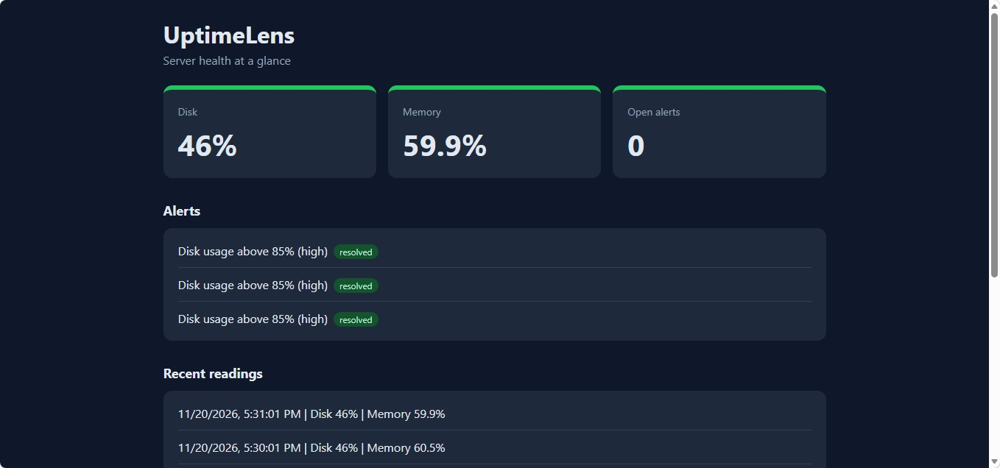

# UptimeLens

A small, self-hosted dashboard that shows how healthy your server is at a glance: disk, memory and open alerts, with automatic alerting. It's a lightweight take on what tools like Datadog do, built to learn cloud and DevOps by running it on a real AWS EC2 server.



## What it does

- Reads the server's **disk usage, memory usage and uptime** every minute
- Shows the latest numbers as colour-coded cards (green, amber, red)
- **Opens an alert automatically** when disk reaches 85% or memory reaches 90%, and **resolves it automatically** when the number recovers
- Refreshes itself every minute, with no page reload
- Only accepts readings from a script that holds a secret key

## How it works

```
 Server (EC2)
 ┌──────────────────────────────────────────────────────┐
 │  cron (every minute)                                 │
 │     └─ send-stats.sh  reads df / free / uptime       │
 │            │  POST /stats  + x-api-key header        │
 │            ▼                                         │
 │  Express app (Docker)  ──►  PostgreSQL (Docker)      │
 │     │  checks limits, opens/resolves alerts          │
 │     ▼                                                │
 │  GET /stats, GET /alerts                             │
 └──────────────────────────────────────────────────────┘
            ▲
            │  fetches every minute
        Browser dashboard (public/index.html)
```

## Tech

Node.js, Express, PostgreSQL, Docker and Docker Compose, Bash and cron, GitHub Actions (CI builds the Docker image on every push).

## API

| Route | Needs API key | What it does |
|---|---|---|
| `GET /stats` | No | Latest readings |
| `POST /stats` | Yes | Save a reading and check alert limits |
| `GET /alerts` | No | Latest alerts |
| `POST /alerts` | Yes | Create an alert by hand |
| `PATCH /alerts/:id` | Yes | Mark an alert resolved |

## Run it on your own server

You need Docker, Docker Compose and git on the machine you want to monitor.

1. Clone the repo:

   ```bash
   git clone https://github.com/Arthur-cloud1/UptimeLens.git
   cd UptimeLens
   ```

2. Create a `.env` file with your own secrets (this file is git-ignored, never commit it):

   ```bash
   DB_PASSWORD=choose-a-strong-password
   API_KEY=$(openssl rand -hex 16)
   ```

   Run `openssl rand -hex 16` yourself and paste the result after `API_KEY=`.

3. Start the app and the database:

   ```bash
   docker compose up -d --build
   ```

4. Create the tables:

   ```bash
   docker compose exec -T db psql -U uptimelens -d uptimelens < schema.sql
   ```

5. Make the script runnable and schedule it. `send-stats.sh` reads the key from your `.env`, so edit the path inside it if your folder is not `/home/ubuntu/UptimeLens`.

   ```bash
   chmod +x send-stats.sh
   crontab -e
   ```

   Add this line:

   ```
   * * * * * /home/ubuntu/UptimeLens/send-stats.sh >> /home/ubuntu/send-stats.log 2>&1
   ```

6. Open `http://YOUR_SERVER_IP:3000`. Readings appear within a minute.

## Security notes

- Write routes require an `x-api-key` header. Without the right key the server answers `401 Unauthorized`.
- Secrets live in `.env`, passed into the container by Docker Compose. They are not in the code or in GitHub.
- The database is not published to the internet, only the app container can reach it.
- On the cloud server, SSH is restricted to my own IP in the AWS security group, and unused ports are closed.

## Known limitations

- The dashboard has no login, so anyone who can reach port 3000 can read the numbers. Writes are protected, reads are not.
- The API key travels over plain HTTP. For real use, put the app behind HTTPS.
- Alert limits (85% disk, 90% memory) are fixed in `index.js`.
- Notifications (email or Slack) are not built yet. Alerts only show on the dashboard.
- The `container_status` and `deploy_log` tables exist but nothing writes to them yet.

## Roadmap

- Email or Slack notifications for new alerts
- Automatic deploy with GitHub Actions
- Trivy vulnerability scan on the Docker image
- HTTPS and a login for the dashboard

## About

Built as a hands-on cloud security and DevOps learning project, with AI-assisted guidance along the way. I ran it on a real AWS EC2 instance, broke it a few times (full disk, locked-out SSH, a diverged git history), and fixed it each time.
